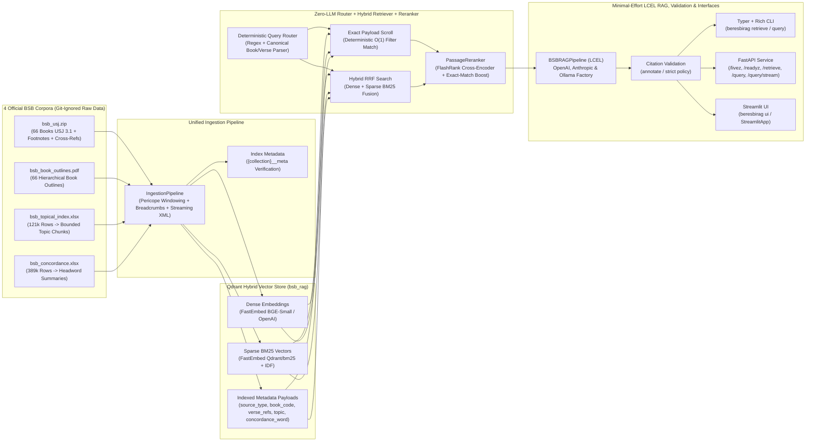

# beresbirag — Berean Standard Bible (BSB) Hybrid RAG Pipeline

**`beresbirag`** is a production-oriented, multi-corpus Retrieval-Augmented Generation (RAG) system built with **Python 3.11+**, **LangChain (LCEL)**, and **Qdrant Hybrid Search (Dense + Sparse BM25 Reciprocal Rank Fusion)** over the complete public-domain **Berean Standard Bible (BSB)** ecosystem.

It is specifically engineered so **small, fast, minimal-effort LLMs** (OpenAI `gpt-4o-mini` / `gpt-5-nano`, Anthropic `claude-haiku-5-5` / `claude-haiku-4-5`, and local Ollama `qwen2.5:1.5b`) achieve high-precision, grounded answers with citation validation without expensive reasoning tokens.

---

## 1. Architecture Overview



### Multi-Corpus Chunking Strategy
1. **BSB Scripture (`bsb_usj.zip`)**: Pericope-aware chunking along USJ `s1`/`s2` section boundaries (capped at 10 verses with a 2-verse sliding overlap), enriched inline with `r` cross-references, `note` footnotes, and hierarchical outline breadcrumbs from `BookOutlineIndex`.
2. **BSB Book Outlines (`bsb_book_outlines.pdf`)**: Parsed via `PyMuPDF` into a 66-book hierarchical `BookOutlineIndex` and book/section overview chunks (`source_type="book_outline"`).
3. **BSB Topical Index (`bsb_topical_index.xlsx`)**: Streamed via constant-memory OpenXML `iterparse` into bounded topic summary chunks (`source_type="topical_index"`).
4. **BSB Concordance (`bsb_concordance.xlsx`)**: Streamed via constant-memory OpenXML `iterparse` into 1 aggregated summary chunk per headword (`source_type="concordance"`) containing occurrence counts, book distribution, representative verse contexts, and normalized `verse_refs`.

---

## 2. Conda Environment (`beresbirag`) Setup

All local development, ingestion, testing, and linting run inside the **`beresbirag`** Conda environment:

```powershell
# 1. Create and activate the Conda environment
conda create -n beresbirag python=3.11 -y
conda run -n beresbirag pip install -e ".[dev]"

# 2. Configure environment variables
Copy-Item .env.example .env
# Edit .env to set OPENAI_API_KEY, ANTHROPIC_API_KEY, or configure local Ollama
```

---

## 3. Docker Compose Quickstart (Qdrant + FastAPI)

Start the Qdrant vector database and the `beresbirag` FastAPI service with Docker Compose:

```powershell
# Start Qdrant (ports 6333/6334) and the API server (port 8000)
docker compose up -d

# Run a fast multi-source smoke ingestion (Genesis, Exodus, John, Revelation + Outlines + Top 50 Topics/Concordance)
conda run -n beresbirag python ./scripts/ingest_all.py --recreate --books GEN,EXO,JHN,REV --max-topics 50 --max-concordance 50

# Or ingest the full 66-book BSB corpus across all 4 sources
conda run -n beresbirag python ./scripts/ingest_all.py --recreate
```

### Upgrading Existing Collections

Collections created before the BM25 IDF fix were built with `modifier=None` on the sparse vector, so BM25 scores ignore inverse document frequency. Queries against such a collection (or one whose dense vector size no longer matches the active embedding model) fail fast with a `CollectionConfigError`. Rebuild the collection once:

```powershell
conda run -n beresbirag python ./scripts/ingest_all.py --recreate
```

---

## 4. CLI & FastAPI Usage Examples

### CLI (`beresbirag`)

```powershell
# Retrieve ranked BSB chunks without calling an LLM
conda run -n beresbirag beresbirag retrieve "Genesis 1:1-5" --top-k 5

# Ask a grounded question with OpenAI (minimal effort)
conda run -n beresbirag beresbirag query "What does Genesis 1:1-5 teach about light, and what footnotes are included?" --provider openai --model gpt-4o-mini --effort minimal

# Ask a grounded question with Anthropic (minimal effort)
conda run -n beresbirag beresbirag query "How does the BSB Book Outline structure the Gospel of John?" --provider anthropic --model claude-haiku-5-5 --effort minimal

# Ask a question offline with Ollama (low-resource profile)
conda run -n beresbirag beresbirag query "How many times does grace occur in the concordance?" --provider ollama --model qwen2.5:1.5b --effort minimal
```

### FastAPI Endpoints (`src/beresbirag/api.py`)

#### PowerShell

```powershell
# Start the FastAPI server locally
conda run -n beresbirag uvicorn beresbirag.api:app --host 0.0.0.0 --port 8000

# Health check
Invoke-RestMethod -Uri http://localhost:8000/health

# Retrieval-only endpoint (no LLM key required)
Invoke-RestMethod -Method Post -Uri http://localhost:8000/retrieve `
  -ContentType "application/json" `
  -Body (@{query = "John 1:1-5"; top_k = 5} | ConvertTo-Json)

# Full grounded RAG query endpoint
Invoke-RestMethod -Method Post -Uri http://localhost:8000/query `
  -ContentType "application/json" `
  -Body (@{
    query = "What is the significance of 666 in the BSB Topical Index and Revelation 13:18?"
    provider = "openai"
    effort = "minimal"
    top_k = 6
  } | ConvertTo-Json)
```

#### Bash (`curl`)

```bash
# Health check
curl http://localhost:8000/health

# Retrieval-only endpoint (no LLM key required)
curl -X POST http://localhost:8000/retrieve \
  -H "Content-Type: application/json" \
  -d '{"query": "John 1:1-5", "top_k": 5}'

# Full grounded RAG query endpoint
curl -X POST http://localhost:8000/query \
  -H "Content-Type: application/json" \
  -d '{
    "query": "What is the significance of 666 in the BSB Topical Index and Revelation 13:18?",
    "provider": "openai",
    "effort": "minimal",
    "top_k": 6
  }'
```

---

## 5. Streamlit Web UI

The interactive Streamlit interface provides grounded scripture search and QA with two execution modes:

- **Install**:
  ```powershell
  conda run -n beresbirag pip install -e ".[ui]"
  # Or install with offline Ollama dependencies:
  conda run -n beresbirag pip install -e ".[ui,offline]"
  ```
- **Run**:
  ```powershell
  conda run -n beresbirag beresbirag ui
  # Or specify custom port and host:
  conda run -n beresbirag beresbirag ui --port 8501 --host 127.0.0.1
  ```
- **Modes**:
  - **Retrieve only (no LLM)**: Fast, zero-LLM search returning ranked chunks, canonical references, and intent classification.
  - **Answer with LLM**: Full RAG pipeline streaming grounded answers with citation validation, deterministic fast-path evaluation for exact citations and concordance counts, and context compression.
- **Provider-safe model picker**: Dynamically lists valid models for OpenAI, Anthropic, or Ollama, preventing invalid pairings.

---

## 6. Multi-LLM Parallel Git Worktree Workflow & Git Hygiene

This repository supports isolated Git worktrees under `./.worktrees/` managed by `./scripts/manage_worktrees.ps1` with strict single-contributor authorship (`Hans Darmawan <work.hansdarmawan001@gmail.com>`) enforced by `.githooks/`:

```powershell
# List active worktrees
powershell -ExecutionPolicy Bypass -File ./scripts/manage_worktrees.ps1 -Action list

# Initialize worktrees for a specific wave (e.g. Wave 6) with BSB_DATA_DIR=../..
powershell -ExecutionPolicy Bypass -File ./scripts/manage_worktrees.ps1 -Action init -Wave 6

# Clean up worktrees whose branches are merged into origin/main
powershell -ExecutionPolicy Bypass -File ./scripts/manage_worktrees.ps1 -Action clean
```

### Verification & Test Suite

```powershell
conda run -n beresbirag ruff check ./src ./scripts ./tests
conda run -n beresbirag ruff format --check ./src ./scripts ./tests
conda run -n beresbirag mypy ./src
conda run -n beresbirag pytest -v
```

---

## 7. Documentation

Detailed guides and specifications are located in the [`docs/`](docs/) directory:

- [Offline Setup and Low-Resource Profile](docs/OFFLINE.md) — Local Ollama setup, model prefetching, 4 GB RAM profile, and diagnostics.
- [Evaluation Benchmark and Verification](docs/EVALUATION.md) — 150-case benchmark evaluation across retrieval accuracy, answer fidelity, and citation validity.
- [Operations Guide](docs/OPERATIONS.md) — Health/readiness probes, API authentication, rate limiting, SSE streaming, Docker deployment, and observability.

---

## 8. License

This project is licensed under the MIT License. See [LICENSE](LICENSE) for details.

Source raw data notice: See [NOTICE](NOTICE). The raw Berean Standard Bible files are not distributed in this repository.
